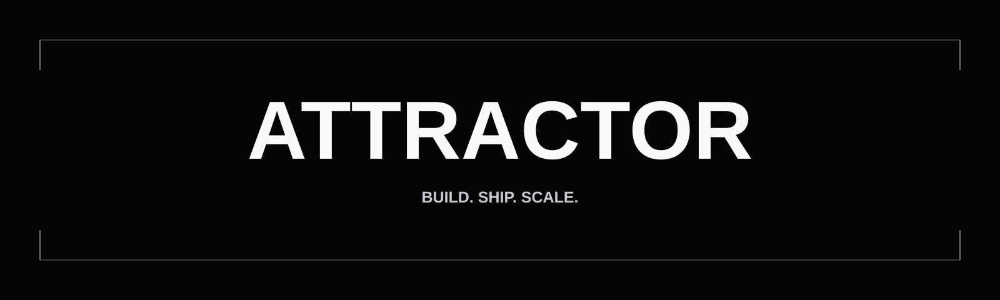

# Attractor open source

We are a Finland-based product partner. We design and build digital products,
and help teams turn promising AI prototypes into dependable services.

Our open-source work shares the practical tools and lessons behind reliable
delivery: useful outcomes, evaluation, evidence, security, operational
ownership, and learning across disciplines.

| Clarify | Build | Ship | Monitor |
| --- | --- | --- | --- |
| Frame the outcome and boundaries. | Make the smallest useful system real. | Prove it is ready for people and production. | Learn from quality, operations, and users. |

## Ship reliable AI

- [Production AI Checklist](https://github.com/attractorhq/production-ai-checklist)
  — assess production readiness and make missing evidence visible in CI.
- [AI Evals Starter](https://github.com/attractorhq/ai-evals-starter)
  — test recorded AI outputs with deterministic, provider-neutral scorers.
- [RAG Quality Workshop](https://github.com/attractorhq/rag-quality-workshop)
  — improve retrieval, grounding, security, monitoring, and cost hands-on.

## Learn together

- [Tips for Building AI](https://github.com/attractorhq/tips-for-building-ai)
  — practical, opinionated advice for teams building real-world AI products.
- [AI Failure Drills](https://github.com/attractorhq/ai-failure-drills)
  — facilitator-ready tabletop exercises for rehearsing production failures.

Every project is Apache-2.0 licensed, maintained in English, and designed to
start without model API keys or paid services.

## Take part

Questions, real experience, and focused contributions are welcome. Read our
[contribution guide](../CONTRIBUTING.md) and the support policy in each
repository before opening an issue.

Attractor is the maintainer. Community value comes first.
